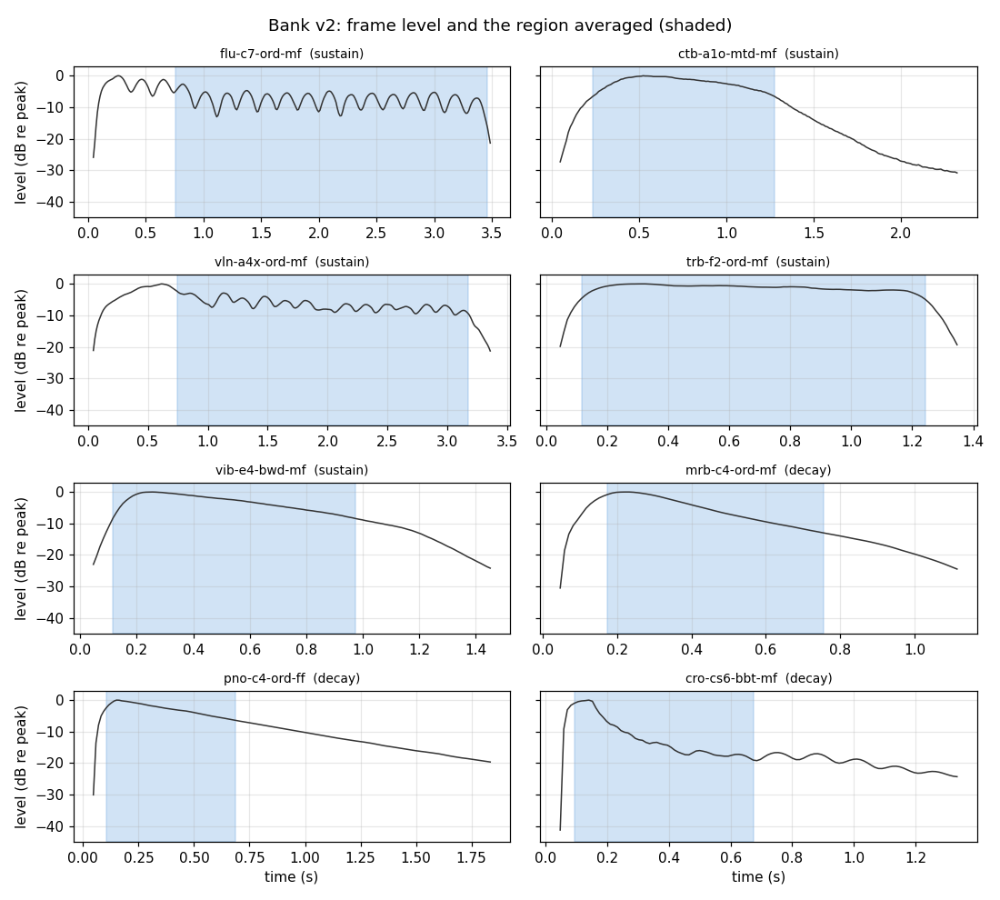

# Bank v2: analysis and coverage report

Generated by `docs/make_bank_report.py` from `Soundbank_McGill/Bank_v2/bank_v2.npz` and `bank_v2.csv`.

## How the spectra were made

Each McGill recording (44.1 kHz, mixed to mono, scaled to -1..1) is cut into 4,096-sample Hamming frames at hop 512. Each frame's power spectrum |X_k|^2 is scaled so its sum is the frame's mean square (Parseval). The Bank spectrum is the mean over the analysed region, so `10*log10(sum)` is the region's level in dBFS.

- **Sustained sounds** (bowed, blown, bowed vibraphone): the frame level is smoothed over 17 frames (about 0.2 s); the reference is the median of frames within 10 dB of the smoothed peak; the region is the longest run within ±4 dB of it, less 2 frames at each end.
- **Decaying sounds** (piano, marimba, xylophone, glockenspiel, crotales, tubular bells, hard-mallet vibraphone): from the loudest frame until 20 dB below it, at most 0.5 s.
- Fallback: the v1 fixed 15% trim when fewer than 3 frames qualify.

| Envelope | Method | Sounds | Region / note length (5th, 50th, 95th pct) | Region length, s | Similarity to v1 (1st, 5th, 50th pct) |
| --- | --- | --- | --- | --- | --- |
| decaying | decay | 347 | 0.10, 0.46, 0.80 | 0.19, 0.58, 0.58 | 0.837, 0.882, 0.988 |
| sustained | sustain | 1168 | 0.56, 0.88, 0.96 | 0.79, 2.58, 4.89 | 0.981, 0.994, 1.000 |

*Similarity to v1* is the cosine between sqrt(v2 power) and the v1 FFTBank magnitude spectrum of the same sound. Sustained sounds barely change; decaying sounds change more because v1 averaged the middle 70% of the whole ring-out.

Sustained sounds that changed most: `pic-fs7-ord-mf` (0.923), `vla-2d6-nhr-mf` (0.925), `vib-fs5-bwd-mf` (0.947), `tpc-cs4-hmo-mf` (0.962), `vlc-g3-ord-mf` (0.962), `vlc-g5-ahr-mf` (0.968), `tpc-as5-hmo-mf` (0.971), `vib-f5-bwd-mf` (0.972).

## Levels

Spectra keep the recorded level. Median level by instrument (dBFS, quietest first):

glk -52, cro -40, pno -36, vlc -34, tpc -34, tbb -32, vln -32, xyl -31, btb -31, bsx -31, cbc -30, clb -29, enh -29, brx -29, pic -29, alx -29, bcl -29, mrb -29, tba -28, vla -28, ctb -28, tnx -28, afl -27, frh -27, trb -27, flu -26, obo -26, spx -26, vib -25, cbs -25, bfl -24, cle -24, bsn -23

**Recorded level is not playing level.** For the 88 piano notes recorded at both pp and ff, ff is a median -4.1 dB relative to pp (10th-90th percentile -10.0 to +1.0 dB): the MUMS tracks were evidently gain-adjusted. Bank levels describe the recordings, not the instruments; a loudness model (or calibrated recordings) is needed before weights can be read as dynamics. `Bank.load(normalize='unit')` gives level-free spectra.

## Coverage

1515 sounds, 33 instruments.

| Family | Instrument | Mode | Sounds | Range (MIDI) | Range |
| --- | --- | --- | --- | --- | --- |
| strings | Violin (vln) | artificial harmonic (ahr) | 13 | 92-104 | gs6-gs7 |
| strings | Violin (vln) | muted (mtd) | 45 | 55-96 | g3-c7 |
| strings | Violin (vln) | natural harmonic (nhr) | 12 | 67-104 | g4-gs7 |
| strings | Violin (vln) | ordinary (ord) | 45 | 55-96 | g3-c7 |
| strings | Viola (vla) | artificial harmonic (ahr) | 13 | 72-84 | c5-c6 |
| strings | Viola (vla) | muted (mtd) | 39 | 48-86 | c3-d6 |
| strings | Viola (vla) | natural harmonic (nhr) | 12 | 60-93 | c4-a6 |
| strings | Viola (vla) | ordinary (ord) | 42 | 48-86 | c3-d6 |
| strings | Cello (vlc) | artificial harmonic (ahr) | 13 | 72-84 | c5-c6 |
| strings | Cello (vlc) | muted (mtd) | 34 | 36-69 | c2-a4 |
| strings | Cello (vlc) | natural harmonic (nhr) | 12 | 48-85 | c3-cs6 |
| strings | Cello (vlc) | ordinary (ord) | 47 | 36-79 | c2-g5 |
| strings | Contrabass (ctb) | muted (mtd) | 45 | 24-65 | c1-f4 |
| strings | Contrabass (ctb) | natural harmonic (nhr) | 12 | 40-71 | e2-b4 |
| strings | Contrabass (ctb) | ordinary (ord) | 44 | 24-64 | c1-e4 |
| flutes | Piccolo (pic) | ordinary (ord) | 30 | 74-103 | d5-g7 |
| flutes | Flute (flu) | ordinary (ord) | 37 | 60-96 | c4-c7 |
| flutes | Alto Flute (afl) | ordinary (ord) | 30 | 55-84 | g3-c6 |
| flutes | Bass Flute (bfl) | ordinary (ord) | 26 | 48-73 | c3-cs5 |
| double reeds | Oboe (obo) | ordinary (ord) | 32 | 58-89 | as3-f6 |
| double reeds | English Horn (enh) | ordinary (ord) | 30 | 52-81 | e3-a5 |
| double reeds | Bassoon (bsn) | ordinary (ord) | 32 | 34-65 | as1-f4 |
| double reeds | Contra Bassoon (cbs) | ordinary (ord) | 32 | 22-53 | as0-f3 |
| clarinets | Eb Clarinet (cle) | ordinary (ord) | 32 | 55-86 | g3-d6 |
| clarinets | Bb Clarinet (clb) | ordinary (ord) | 37 | 50-86 | d3-d6 |
| clarinets | Bass Clarinet (bcl) | ordinary (ord) | 25 | 37-61 | cs2-cs4 |
| clarinets | Contra Bass Clarinet (cbc) | ordinary (ord) | 25 | 30-54 | fs1-fs3 |
| saxophones | Soprano Sax (spx) | ordinary (ord) | 15 | 73-87 | cs5-ds6 |
| saxophones | Alto Sax (alx) | ordinary (ord) | 14 | 61-74 | cs4-d5 |
| saxophones | Tenor Sax (tnx) | ordinary (ord) | 14 | 48-61 | c3-cs4 |
| saxophones | Baritone Sax (brx) | ordinary (ord) | 13 | 36-48 | c2-c3 |
| saxophones | Bass Saxophone (bsx) | ordinary (ord) | 8 | 32-39 | gs1-ds2 |
| brass | C Trumpet (tpc) | harmon mute (open) (hmo) | 31 | 54-84 | fs3-c6 |
| brass | C Trumpet (tpc) | ordinary (ord) | 34 | 54-87 | fs3-ds6 |
| brass | French Horn (frh) | muted (mtd) | 37 | 38-74 | d2-d5 |
| brass | French Horn (frh) | ordinary (ord) | 37 | 38-74 | d2-d5 |
| brass | Tenor Trombone (trb) | ordinary (ord) | 36 | 40-75 | e2-ds5 |
| brass | Tenor Trombone (trb) | pedal tone (ped) | 6 | 29-34 | f1-as1 |
| brass | Tenor Trombone (trb) | straight mute (stm) | 33 | 40-72 | e2-c5 |
| brass | Bass Trombone (btb) | ordinary (ord) | 25 | 29-53 | f1-f3 |
| brass | Tuba (tba) | ordinary (ord) | 32 | 28-67 | e1-g4 |
| keyboard | Piano (pno) | ordinary (ord) | 176 | 21-108 | a0-c8 |
| percussion | Marimba (mrb) | ordinary (ord) | 56 | 41-96 | f2-c7 |
| percussion | Xylophone (xyl) | ordinary (ord) | 44 | 65-108 | f4-c8 |
| percussion | Vibraphone (vib) | bowed (bwd) | 37 | 53-89 | f3-f6 |
| percussion | Vibraphone (vib) | hard mallet (hdm) | 37 | 53-89 | f3-f6 |
| percussion | Glockenspiel (glk) | brass beater (bbt) | 1 | 97-97 | cs7-cs7 |
| percussion | Crotales (cro) | brass beater (bbt) | 13 | 84-96 | c6-c7 |
| percussion | Tubular Bells (tbb) | ordinary (ord) | 20 | 60-79 | c4-g5 |

Dynamics: {'mf': 1339, 'ff': 88, 'pp': 88}. Only piano has pp and ff.

### Gaps

- François' spreadsheets list 1544 sounds. Missing from the Bank: 29 (Glockenspiel 29).
- `tpt-fs3-hmo-mf` in the spreadsheet and the recording's file name is a typo for `tpc-fs3-hmo-mf` (handled by `laborch.build.NAME_FIXES`).
- Thin instruments: Glockenspiel 1, Bass Saxophone 8.
- Dynamics: strings, winds, brass and percussion are mf only.
- Modes not recorded: e.g. string pizzicato and sul ponticello, flutter-tongue, wind multiphonics (some trumpet mutes and bassoon multiphonics are in MiscSounds as Targets).

